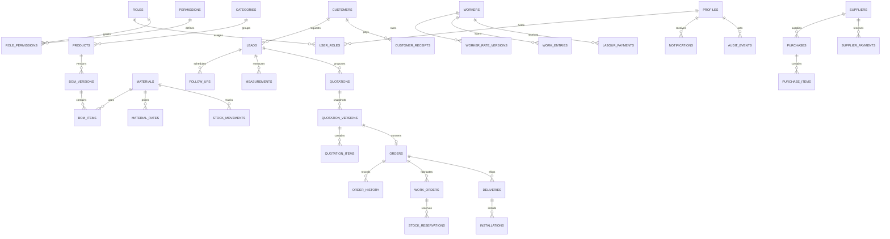

> Version: 0.1 | Owner: project team | Updated: 2026-10-14 | Status: planning draft; not implemented

# Conceptual ERD — draft

This source-era diagram describes intended relationships, not exact applied names. For the current 58-table schema, foreign keys, RLS policies and constraints use the generated [schema dictionary](schema-dictionary.md) and `actual-schema.json`. The live migration ledger has 38 entries. A fully synchronized visual ERD remains a Phase 02 acceptance item.

Additional planned entities: addresses, media_assets and contextual links, gallery/content/reviews, quality checks, expense categories/expenses, owner withdrawals, financial entries, settings and idempotency records. Complete foreign keys, cardinality, deletion policy, constraints and transactional boundaries must be reviewed in Phase 02; this is not executable SQL.

