# Applied database relationship diagram

Generated from PostgreSQL catalog metadata captured at 2026-10-18T09:31:40.807Z. 58 public tables, 96 foreign keys, 46 applied migrations. No application records are included.

Arrows point from referencing table to referenced table. Labels preserve the ordered child and parent columns, including composite foreign keys. External referenced tables are included explicitly. Cardinality is not inferred from names; exact nullability, uniqueness, checks, referential actions and validation state are recorded in the schema dictionary and constraint table below.

```mermaid
flowchart LR
  auth_users["auth.users"]
  public_audit_logs["public.audit_logs"]
  public_bom_items["public.bom_items"]
  public_bom_versions["public.bom_versions"]
  public_calculation_rules["public.calculation_rules"]
  public_catalog_copies["public.catalog_copies"]
  public_categories["public.categories"]
  public_customer_payments["public.customer_payments"]
  public_customers["public.customers"]
  public_deliveries["public.deliveries"]
  public_estimate_snapshots["public.estimate_snapshots"]
  public_expense_reversals["public.expense_reversals"]
  public_expenses["public.expenses"]
  public_finance_period_closures["public.finance_period_closures"]
  public_financial_adjustments["public.financial_adjustments"]
  public_follow_ups["public.follow_ups"]
  public_gallery_items["public.gallery_items"]
  public_installations["public.installations"]
  public_labour_payments["public.labour_payments"]
  public_labour_rates["public.labour_rates"]
  public_lead_attachments["public.lead_attachments"]
  public_lead_notes["public.lead_notes"]
  public_lead_status_history["public.lead_status_history"]
  public_leads["public.leads"]
  public_material_rates["public.material_rates"]
  public_materials["public.materials"]
  public_measurements["public.measurements"]
  public_media_assets["public.media_assets"]
  public_notifications["public.notifications"]
  public_order_status_history["public.order_status_history"]
  public_orders["public.orders"]
  public_owner_withdrawals["public.owner_withdrawals"]
  public_permissions["public.permissions"]
  public_product_media["public.product_media"]
  public_product_options["public.product_options"]
  public_product_variants["public.product_variants"]
  public_products["public.products"]
  public_profiles["public.profiles"]
  public_purchase_attachments["public.purchase_attachments"]
  public_purchase_items["public.purchase_items"]
  public_purchase_returns["public.purchase_returns"]
  public_purchases["public.purchases"]
  public_quality_checks["public.quality_checks"]
  public_quotation_versions["public.quotation_versions"]
  public_quotations["public.quotations"]
  public_reviews["public.reviews"]
  public_role_permissions["public.role_permissions"]
  public_roles["public.roles"]
  public_site_settings["public.site_settings"]
  public_stock_movements["public.stock_movements"]
  public_stock_reservations["public.stock_reservations"]
  public_supplier_payments["public.supplier_payments"]
  public_suppliers["public.suppliers"]
  public_upload_intents["public.upload_intents"]
  public_user_roles["public.user_roles"]
  public_website_sections["public.website_sections"]
  public_work_entries["public.work_entries"]
  public_work_orders["public.work_orders"]
  public_workers["public.workers"]
  public_audit_logs -->|"actor_id → id"| public_profiles
  public_bom_items -->|"bom_id → id"| public_bom_versions
  public_bom_items -->|"material_id → id"| public_materials
  public_bom_versions -->|"product_id → id"| public_products
  public_calculation_rules -->|"product_id → id"| public_products
  public_catalog_copies -->|"actor_id → id"| public_profiles
  public_catalog_copies -->|"product_id → id"| public_products
  public_catalog_copies -->|"source_id → id"| public_products
  public_categories -->|"image_media_id → id"| public_media_assets
  public_categories -->|"parent_id → id"| public_categories
  public_customer_payments -->|"created_by → id"| public_profiles
  public_customer_payments -->|"order_id → id"| public_orders
  public_customers -->|"user_id → id"| public_profiles
  public_deliveries -->|"order_id → id"| public_orders
  public_deliveries -->|"proof_media_id → id"| public_media_assets
  public_estimate_snapshots -->|"bom_id → id"| public_bom_versions
  public_estimate_snapshots -->|"product_id → id"| public_products
  public_expense_reversals -->|"created_by → id"| public_profiles
  public_expense_reversals -->|"expense_id → id"| public_expenses
  public_expenses -->|"order_id → id"| public_orders
  public_finance_period_closures -->|"created_by → id"| public_profiles
  public_financial_adjustments -->|"created_by → id"| public_profiles
  public_financial_adjustments -->|"order_id → id"| public_orders
  public_financial_adjustments -->|"purchase_id → id"| public_purchases
  public_financial_adjustments -->|"worker_id → id"| public_workers
  public_follow_ups -->|"assigned_to → id"| public_profiles
  public_follow_ups -->|"lead_id → id"| public_leads
  public_gallery_items -->|"category_id → id"| public_categories
  public_gallery_items -->|"media_id → id"| public_media_assets
  public_installations -->|"delivery_id → id"| public_deliveries
  public_labour_payments -->|"created_by → id"| public_profiles
  public_labour_payments -->|"worker_id → id"| public_workers
  public_labour_rates -->|"worker_id → id"| public_workers
  public_lead_attachments -->|"lead_id → id"| public_leads
  public_lead_attachments -->|"media_id → id"| public_media_assets
  public_lead_notes -->|"created_by → id"| public_profiles
  public_lead_notes -->|"lead_id → id"| public_leads
  public_lead_status_history -->|"actor_id → id"| public_profiles
  public_lead_status_history -->|"lead_id → id"| public_leads
  public_leads -->|"assigned_to → id"| public_profiles
  public_leads -->|"customer_id → id"| public_customers
  public_leads -->|"duplicate_of → id"| public_leads
  public_leads -->|"product_id → id"| public_products
  public_material_rates -->|"created_by → id"| public_profiles
  public_material_rates -->|"material_id → id"| public_materials
  public_measurements -->|"lead_id → id"| public_leads
  public_measurements -->|"verified_by → id"| public_profiles
  public_media_assets -->|"owner_user_id → id"| public_profiles
  public_notifications -->|"user_id → id"| public_profiles
  public_order_status_history -->|"actor_id → id"| public_profiles
  public_order_status_history -->|"order_id → id"| public_orders
  public_orders -->|"customer_id → id"| public_customers
  public_orders -->|"quotation_version_id → id"| public_quotation_versions
  public_owner_withdrawals -->|"created_by → id"| public_profiles
  public_product_media -->|"media_id → id"| public_media_assets
  public_product_media -->|"product_id → id"| public_products
  public_product_options -->|"product_id → id"| public_products
  public_product_variants -->|"product_id → id"| public_products
  public_products -->|"category_id → id"| public_categories
  public_profiles -->|"id → id"| auth_users
  public_purchase_attachments -->|"created_by → id"| public_profiles
  public_purchase_attachments -->|"media_id → id"| public_media_assets
  public_purchase_attachments -->|"purchase_id → id"| public_purchases
  public_purchase_items -->|"material_id → id"| public_materials
  public_purchase_items -->|"purchase_id → id"| public_purchases
  public_purchase_returns -->|"created_by → id"| public_profiles
  public_purchase_returns -->|"purchase_item_id → id"| public_purchase_items
  public_purchases -->|"supplier_id → id"| public_suppliers
  public_quality_checks -->|"created_by → id"| public_profiles
  public_quality_checks -->|"work_order_id → id"| public_work_orders
  public_quotation_versions -->|"quotation_id → id"| public_quotations
  public_quotations -->|"customer_id → id"| public_customers
  public_quotations -->|"lead_id → id"| public_leads
  public_quotations -->|"revision_actor → id"| public_profiles
  public_quotations -->|"revision_of → id"| public_quotations
  public_role_permissions -->|"permission_id → id"| public_permissions
  public_role_permissions -->|"role_id → id"| public_roles
  public_stock_movements -->|"created_by → id"| public_profiles
  public_stock_movements -->|"material_id → id"| public_materials
  public_stock_movements -->|"purchase_id → id"| public_purchases
  public_stock_movements -->|"work_order_id → id"| public_work_orders
  public_stock_reservations -->|"material_id → id"| public_materials
  public_stock_reservations -->|"released_by → id"| public_profiles
  public_stock_reservations -->|"work_order_id → id"| public_work_orders
  public_supplier_payments -->|"created_by → id"| public_profiles
  public_supplier_payments -->|"purchase_id → id"| public_purchases
  public_upload_intents -->|"lead_id → id"| public_leads
  public_upload_intents -->|"owner_user_id → id"| public_profiles
  public_user_roles -->|"role_id → id"| public_roles
  public_user_roles -->|"user_id → id"| public_profiles
  public_work_entries -->|"created_by → id"| public_profiles
  public_work_entries -->|"labour_rate_id → id"| public_labour_rates
  public_work_entries -->|"work_order_id → id"| public_work_orders
  public_work_entries -->|"worker_id → id"| public_workers
  public_work_orders -->|"assigned_to → id"| public_profiles
  public_work_orders -->|"order_id → id"| public_orders
```

## Applied constraints

| Table | Constraint | Kind | Validated | Definition |
| --- | --- | --- | --- | --- |
| public.audit_logs | audit_logs_actor_id_fkey | f | true | FOREIGN KEY (actor_id) REFERENCES profiles(id) |
| public.audit_logs | audit_logs_pkey | p | true | PRIMARY KEY (id) |
| public.bom_items | bom_items_bom_id_fkey | f | true | FOREIGN KEY (bom_id) REFERENCES bom_versions(id) |
| public.bom_items | bom_items_bom_id_material_id_key | u | true | UNIQUE (bom_id, material_id) |
| public.bom_items | bom_items_material_id_fkey | f | true | FOREIGN KEY (material_id) REFERENCES materials(id) |
| public.bom_items | bom_items_pkey | p | true | PRIMARY KEY (id) |
| public.bom_items | bom_items_quantity_per_sq_m_check | c | true | CHECK (quantity_per_sq_m > 0::numeric) |
| public.bom_items | bom_items_wastage_percent_check | c | true | CHECK (wastage_percent >= 0::numeric AND wastage_percent <= 30::numeric) |
| public.bom_items | finite_quantity_per_sq_m | c | true | CHECK (quantity_per_sq_m::text <> ALL (ARRAY['NaN'::text, 'Infinity'::text, '-Infinity'::text])) |
| public.bom_items | finite_wastage_percent | c | true | CHECK (wastage_percent::text <> ALL (ARRAY['NaN'::text, 'Infinity'::text, '-Infinity'::text])) |
| public.bom_versions | bom_versions_pkey | p | true | PRIMARY KEY (id) |
| public.bom_versions | bom_versions_product_id_fkey | f | true | FOREIGN KEY (product_id) REFERENCES products(id) |
| public.bom_versions | bom_versions_product_id_version_key | u | true | UNIQUE (product_id, version) |
| public.bom_versions | bom_versions_status_check | c | true | CHECK (status = ANY (ARRAY['draft'::text, 'published'::text, 'archived'::text])) |
| public.bom_versions | bom_versions_version_check | c | true | CHECK (version > 0) |
| public.calculation_rules | calculation_rules_delivery_minor_check | c | true | CHECK (delivery_minor >= 0) |
| public.calculation_rules | calculation_rules_finish_minor_per_sq_m_check | c | true | CHECK (finish_minor_per_sq_m >= 0) |
| public.calculation_rules | calculation_rules_hardware_minor_check | c | true | CHECK (hardware_minor >= 0) |
| public.calculation_rules | calculation_rules_installation_minor_check | c | true | CHECK (installation_minor >= 0) |
| public.calculation_rules | calculation_rules_labour_minor_per_sq_m_check | c | true | CHECK (labour_minor_per_sq_m >= 0) |
| public.calculation_rules | calculation_rules_margin_bps_check | c | true | CHECK (margin_bps >= 0 AND margin_bps <= 10000) |
| public.calculation_rules | calculation_rules_pkey | p | true | PRIMARY KEY (id) |
| public.calculation_rules | calculation_rules_product_id_fkey | f | true | FOREIGN KEY (product_id) REFERENCES products(id) |
| public.calculation_rules | calculation_rules_product_id_version_key | u | true | UNIQUE (product_id, version) |
| public.calculation_rules | calculation_rules_range_percent_check | c | true | CHECK (range_percent >= 0 AND range_percent <= 50) |
| public.calculation_rules | calculation_rules_status_check | c | true | CHECK (status = ANY (ARRAY['draft'::text, 'published'::text, 'archived'::text])) |
| public.calculation_rules | calculation_rules_version_check | c | true | CHECK (version > 0) |
| public.catalog_copies | catalog_copies_actor_id_fkey | f | true | FOREIGN KEY (actor_id) REFERENCES profiles(id) |
| public.catalog_copies | catalog_copies_pkey | p | true | PRIMARY KEY (id) |
| public.catalog_copies | catalog_copies_product_id_fkey | f | true | FOREIGN KEY (product_id) REFERENCES products(id) |
| public.catalog_copies | catalog_copies_source_id_fkey | f | true | FOREIGN KEY (source_id) REFERENCES products(id) |
| public.categories | categories_check | c | true | CHECK (parent_id IS DISTINCT FROM id) |
| public.categories | categories_image_media_id_fkey | f | true | FOREIGN KEY (image_media_id) REFERENCES media_assets(id) |
| public.categories | categories_parent_id_fkey | f | true | FOREIGN KEY (parent_id) REFERENCES categories(id) |
| public.categories | categories_pkey | p | true | PRIMARY KEY (id) |
| public.categories | categories_slug_key | u | true | UNIQUE (slug) |
| public.customer_payments | customer_payments_amount_minor_check | c | true | CHECK (amount_minor > 0) |
| public.customer_payments | customer_payments_created_by_fkey | f | true | FOREIGN KEY (created_by) REFERENCES profiles(id) |
| public.customer_payments | customer_payments_idempotency_key_key | u | true | UNIQUE (idempotency_key) |
| public.customer_payments | customer_payments_mode_check | c | true | CHECK (mode = ANY (ARRAY['cash'::text, 'bank'::text, 'upi'::text, 'cheque'::text])) |
| public.customer_payments | customer_payments_order_id_fkey | f | true | FOREIGN KEY (order_id) REFERENCES orders(id) |
| public.customer_payments | customer_payments_pkey | p | true | PRIMARY KEY (id) |
| public.customers | customers_pkey | p | true | PRIMARY KEY (id) |
| public.customers | customers_user_id_fkey | f | true | FOREIGN KEY (user_id) REFERENCES profiles(id) |
| public.customers | customers_user_id_key | u | true | UNIQUE (user_id) |
| public.deliveries | deliveries_order_id_fkey | f | true | FOREIGN KEY (order_id) REFERENCES orders(id) |
| public.deliveries | deliveries_pkey | p | true | PRIMARY KEY (id) |
| public.deliveries | deliveries_proof_media_id_fkey | f | true | FOREIGN KEY (proof_media_id) REFERENCES media_assets(id) |
| public.deliveries | deliveries_status_check | c | true | CHECK (status = ANY (ARRAY['scheduled'::text, 'dispatched'::text, 'delivered'::text])) |
| public.estimate_snapshots | estimate_snapshots_bom_id_fkey | f | true | FOREIGN KEY (bom_id) REFERENCES bom_versions(id) |
| public.estimate_snapshots | estimate_snapshots_pkey | p | true | PRIMARY KEY (id) |
| public.estimate_snapshots | estimate_snapshots_product_id_fkey | f | true | FOREIGN KEY (product_id) REFERENCES products(id) |
| public.expense_reversals | expense_reversals_amount_minor_check | c | true | CHECK (amount_minor > 0) |
| public.expense_reversals | expense_reversals_created_by_fkey | f | true | FOREIGN KEY (created_by) REFERENCES profiles(id) |
| public.expense_reversals | expense_reversals_expense_id_fkey | f | true | FOREIGN KEY (expense_id) REFERENCES expenses(id) |
| public.expense_reversals | expense_reversals_expense_id_key | u | true | UNIQUE (expense_id) |
| public.expense_reversals | expense_reversals_idempotency_key_key | u | true | UNIQUE (idempotency_key) |
| public.expense_reversals | expense_reversals_pkey | p | true | PRIMARY KEY (id) |
| public.expense_reversals | expense_reversals_reason_check | c | true | CHECK (length(reason) >= 3 AND length(reason) <= 500) |
| public.expenses | expenses_amount_minor_check | c | true | CHECK (amount_minor > 0) |
| public.expenses | expenses_mode_check | c | true | CHECK (mode = ANY (ARRAY['cash'::text, 'bank'::text, 'upi'::text, 'cheque'::text])) |
| public.expenses | expenses_order_id_fkey | f | true | FOREIGN KEY (order_id) REFERENCES orders(id) |
| public.expenses | expenses_pkey | p | true | PRIMARY KEY (id) |
| public.expenses | expenses_reference_key | u | true | UNIQUE (reference) |
| public.expenses | expenses_status_check | c | true | CHECK (status = ANY (ARRAY['draft'::text, 'approved'::text])) |
| public.finance_period_closures | finance_period_closures_closed_through_key | u | true | UNIQUE (closed_through) |
| public.finance_period_closures | finance_period_closures_created_by_fkey | f | true | FOREIGN KEY (created_by) REFERENCES profiles(id) |
| public.finance_period_closures | finance_period_closures_idempotency_key_key | u | true | UNIQUE (idempotency_key) |
| public.finance_period_closures | finance_period_closures_pkey | p | true | PRIMARY KEY (id) |
| public.finance_period_closures | finance_period_closures_reason_check | c | true | CHECK (length(reason) >= 3 AND length(reason) <= 500) |
| public.financial_adjustments | financial_adjustments_amount_minor_check | c | true | CHECK (amount_minor > 0) |
| public.financial_adjustments | financial_adjustments_created_by_fkey | f | true | FOREIGN KEY (created_by) REFERENCES profiles(id) |
| public.financial_adjustments | financial_adjustments_idempotency_key_key | u | true | UNIQUE (idempotency_key) |
| public.financial_adjustments | financial_adjustments_kind_check | c | true | CHECK (kind = ANY (ARRAY['customer_payment_reversal'::text, 'supplier_payment_reversal'::text, 'labour_payment_reversal'::text, 'withdrawal_reversal'::text, 'work_entry_reversal'::text, 'supplier_refund'::text, 'customer_refund'::text])) |
| public.financial_adjustments | financial_adjustments_kind_reference_key | u | true | UNIQUE (kind, reference) |
| public.financial_adjustments | financial_adjustments_mode_check | c | true | CHECK (mode = ANY (ARRAY['cash'::text, 'bank'::text, 'upi'::text, 'cheque'::text])) |
| public.financial_adjustments | financial_adjustments_order_id_fkey | f | true | FOREIGN KEY (order_id) REFERENCES orders(id) |
| public.financial_adjustments | financial_adjustments_pkey | p | true | PRIMARY KEY (id) |
| public.financial_adjustments | financial_adjustments_purchase_id_fkey | f | true | FOREIGN KEY (purchase_id) REFERENCES purchases(id) |
| public.financial_adjustments | financial_adjustments_reason_check | c | true | CHECK (length(reason) >= 3 AND length(reason) <= 500) |
| public.financial_adjustments | financial_adjustments_reference_check | c | true | CHECK (length(reference) >= 1 AND length(reference) <= 200) |
| public.financial_adjustments | financial_adjustments_worker_id_fkey | f | true | FOREIGN KEY (worker_id) REFERENCES workers(id) |
| public.follow_ups | follow_ups_assigned_to_fkey | f | true | FOREIGN KEY (assigned_to) REFERENCES profiles(id) |
| public.follow_ups | follow_ups_lead_id_fkey | f | true | FOREIGN KEY (lead_id) REFERENCES leads(id) |
| public.follow_ups | follow_ups_pkey | p | true | PRIMARY KEY (id) |
| public.follow_ups | follow_ups_status_check | c | true | CHECK (status = ANY (ARRAY['pending'::text, 'completed'::text])) |
| public.gallery_items | gallery_items_category_id_fkey | f | true | FOREIGN KEY (category_id) REFERENCES categories(id) |
| public.gallery_items | gallery_items_check | c | true | CHECK (status <> 'published'::text OR consent_confirmed) |
| public.gallery_items | gallery_items_media_id_fkey | f | true | FOREIGN KEY (media_id) REFERENCES media_assets(id) |
| public.gallery_items | gallery_items_pkey | p | true | PRIMARY KEY (id) |
| public.gallery_items | gallery_items_status_check | c | true | CHECK (status = ANY (ARRAY['draft'::text, 'published'::text, 'archived'::text])) |
| public.installations | installations_check | c | true | CHECK (status <> 'completed'::text OR customer_confirmed) |
| public.installations | installations_delivery_id_fkey | f | true | FOREIGN KEY (delivery_id) REFERENCES deliveries(id) |
| public.installations | installations_pkey | p | true | PRIMARY KEY (id) |
| public.installations | installations_status_check | c | true | CHECK (status = ANY (ARRAY['pending'::text, 'completed'::text])) |
| public.labour_payments | labour_payments_amount_minor_check | c | true | CHECK (amount_minor > 0) |
| public.labour_payments | labour_payments_created_by_fkey | f | true | FOREIGN KEY (created_by) REFERENCES profiles(id) |
| public.labour_payments | labour_payments_idempotency_key_key | u | true | UNIQUE (idempotency_key) |
| public.labour_payments | labour_payments_mode_check | c | true | CHECK (mode = ANY (ARRAY['cash'::text, 'bank'::text, 'upi'::text, 'cheque'::text])) |
| public.labour_payments | labour_payments_pkey | p | true | PRIMARY KEY (id) |
| public.labour_payments | labour_payments_worker_id_fkey | f | true | FOREIGN KEY (worker_id) REFERENCES workers(id) |
| public.labour_rates | labour_rates_pkey | p | true | PRIMARY KEY (id) |
| public.labour_rates | labour_rates_rate_minor_check | c | true | CHECK (rate_minor > 0) |
| public.labour_rates | labour_rates_unit_check | c | true | CHECK (unit = ANY (ARRAY['kg'::text, 'piece'::text, 'hour'::text])) |
| public.labour_rates | labour_rates_worker_id_fkey | f | true | FOREIGN KEY (worker_id) REFERENCES workers(id) |
| public.lead_attachments | lead_attachments_lead_id_fkey | f | true | FOREIGN KEY (lead_id) REFERENCES leads(id) |
| public.lead_attachments | lead_attachments_media_id_fkey | f | true | FOREIGN KEY (media_id) REFERENCES media_assets(id) |
| public.lead_attachments | lead_attachments_media_id_key | u | true | UNIQUE (media_id) |
| public.lead_attachments | lead_attachments_pkey | p | true | PRIMARY KEY (id) |
| public.lead_notes | lead_notes_created_by_fkey | f | true | FOREIGN KEY (created_by) REFERENCES profiles(id) |
| public.lead_notes | lead_notes_lead_id_fkey | f | true | FOREIGN KEY (lead_id) REFERENCES leads(id) |
| public.lead_notes | lead_notes_pkey | p | true | PRIMARY KEY (id) |
| public.lead_status_history | lead_status_history_actor_id_fkey | f | true | FOREIGN KEY (actor_id) REFERENCES profiles(id) |
| public.lead_status_history | lead_status_history_lead_id_fkey | f | true | FOREIGN KEY (lead_id) REFERENCES leads(id) |
| public.lead_status_history | lead_status_history_pkey | p | true | PRIMARY KEY (id) |
| public.leads | leads_assigned_to_fkey | f | true | FOREIGN KEY (assigned_to) REFERENCES profiles(id) |
| public.leads | leads_configuration_snapshot_check | c | true | CHECK (jsonb_typeof(configuration_snapshot) = 'object'::text) |
| public.leads | leads_customer_id_fkey | f | true | FOREIGN KEY (customer_id) REFERENCES customers(id) |
| public.leads | leads_duplicate_of_fkey | f | true | FOREIGN KEY (duplicate_of) REFERENCES leads(id) |
| public.leads | leads_pkey | p | true | PRIMARY KEY (id) |
| public.leads | leads_product_id_fkey | f | true | FOREIGN KEY (product_id) REFERENCES products(id) |
| public.leads | leads_source_check | c | true | CHECK (source = ANY (ARRAY['google'::text, 'instagram'::text, 'facebook'::text, 'whatsapp'::text, 'direct'::text, 'referral'::text, 'other'::text])) |
| public.leads | leads_status_check | c | true | CHECK (status = ANY (ARRAY['NEW'::text, 'CONTACTED'::text, 'REQUIREMENT_CONFIRMED'::text, 'MEASUREMENT_PENDING'::text, 'MEASUREMENT_DONE'::text, 'QUOTATION_SENT'::text, 'NEGOTIATION'::text, 'ORDER_CONFIRMED'::text, 'PRODUCTION'::text, 'COMPLETED'::text, 'LOST'::text])) |
| public.material_rates | material_rates_created_by_fkey | f | true | FOREIGN KEY (created_by) REFERENCES profiles(id) |
| public.material_rates | material_rates_currency_check | c | true | CHECK (currency = 'INR'::text) |
| public.material_rates | material_rates_material_id_fkey | f | true | FOREIGN KEY (material_id) REFERENCES materials(id) |
| public.material_rates | material_rates_pkey | p | true | PRIMARY KEY (id) |
| public.material_rates | material_rates_purchase_minor_check | c | true | CHECK (purchase_minor >= 0) |
| public.material_rates | material_rates_selling_minor_check | c | true | CHECK (selling_minor >= 0) |
| public.materials | finite_reorder_level | c | true | CHECK (reorder_level::text <> ALL (ARRAY['NaN'::text, 'Infinity'::text, '-Infinity'::text])) |
| public.materials | finite_thickness_mm | c | true | CHECK (thickness_mm::text <> ALL (ARRAY['NaN'::text, 'Infinity'::text, '-Infinity'::text])) |
| public.materials | finite_weight_kg_per_unit | c | true | CHECK (weight_kg_per_unit::text <> ALL (ARRAY['NaN'::text, 'Infinity'::text, '-Infinity'::text])) |
| public.materials | materials_code_key | u | true | UNIQUE (code) |
| public.materials | materials_pkey | p | true | PRIMARY KEY (id) |
| public.materials | materials_reorder_level_check | c | true | CHECK (reorder_level >= 0::numeric) |
| public.materials | materials_thickness_mm_check | c | true | CHECK (thickness_mm > 0::numeric) |
| public.materials | materials_unit_check | c | true | CHECK (unit = ANY (ARRAY['kg'::text, 'm'::text, 'piece'::text, 'litre'::text, 'sheet'::text])) |
| public.materials | materials_weight_kg_per_unit_check | c | true | CHECK (weight_kg_per_unit > 0::numeric) |
| public.measurements | finite_depth_mm | c | true | CHECK (depth_mm::text <> ALL (ARRAY['NaN'::text, 'Infinity'::text, '-Infinity'::text])) |
| public.measurements | finite_height_mm | c | true | CHECK (height_mm::text <> ALL (ARRAY['NaN'::text, 'Infinity'::text, '-Infinity'::text])) |
| public.measurements | finite_width_mm | c | true | CHECK (width_mm::text <> ALL (ARRAY['NaN'::text, 'Infinity'::text, '-Infinity'::text])) |
| public.measurements | measurements_depth_mm_check | c | true | CHECK (depth_mm > 0::numeric) |
| public.measurements | measurements_height_mm_check | c | true | CHECK (height_mm > 0::numeric) |
| public.measurements | measurements_lead_id_fkey | f | true | FOREIGN KEY (lead_id) REFERENCES leads(id) |
| public.measurements | measurements_pkey | p | true | PRIMARY KEY (id) |
| public.measurements | measurements_verified_by_fkey | f | true | FOREIGN KEY (verified_by) REFERENCES profiles(id) |
| public.measurements | measurements_width_mm_check | c | true | CHECK (width_mm > 0::numeric) |
| public.media_assets | media_assets_asset_id_key | u | true | UNIQUE (asset_id) |
| public.media_assets | media_assets_bytes_check | c | true | CHECK (bytes > 0) |
| public.media_assets | media_assets_duration_seconds_check | c | true | CHECK (duration_seconds > 0::numeric AND duration_seconds <= 120::numeric) |
| public.media_assets | media_assets_owner_user_id_fkey | f | true | FOREIGN KEY (owner_user_id) REFERENCES profiles(id) |
| public.media_assets | media_assets_pkey | p | true | PRIMARY KEY (id) |
| public.media_assets | media_assets_public_id_key | u | true | UNIQUE (public_id) |
| public.media_assets | media_assets_visibility_check | c | true | CHECK (visibility = ANY (ARRAY['public'::text, 'private'::text])) |
| public.media_assets | private_invoice_pdf_only | c | true | CHECK (format <> 'pdf'::text OR context = 'invoice'::text AND visibility = 'private'::text AND resource_type = 'image'::text AND owner_user_id IS NOT NULL) |
| public.notifications | notifications_event_key_key | u | true | UNIQUE (event_key) |
| public.notifications | notifications_pkey | p | true | PRIMARY KEY (id) |
| public.notifications | notifications_user_id_fkey | f | true | FOREIGN KEY (user_id) REFERENCES profiles(id) |
| public.order_status_history | order_status_history_actor_id_fkey | f | true | FOREIGN KEY (actor_id) REFERENCES profiles(id) |
| public.order_status_history | order_status_history_order_id_fkey | f | true | FOREIGN KEY (order_id) REFERENCES orders(id) |
| public.order_status_history | order_status_history_pkey | p | true | PRIMARY KEY (id) |
| public.orders | orders_customer_id_fkey | f | true | FOREIGN KEY (customer_id) REFERENCES customers(id) |
| public.orders | orders_pkey | p | true | PRIMARY KEY (id) |
| public.orders | orders_quotation_version_id_fkey | f | true | FOREIGN KEY (quotation_version_id) REFERENCES quotation_versions(id) |
| public.orders | orders_quotation_version_id_key | u | true | UNIQUE (quotation_version_id) |
| public.orders | orders_status_check | c | true | CHECK (status = ANY (ARRAY['CONFIRMED'::text, 'ADVANCE_RECEIVED'::text, 'MEASUREMENT_CONFIRMED'::text, 'PRODUCTION_PENDING'::text, 'PRODUCTION_STARTED'::text, 'FABRICATION_COMPLETED'::text, 'FINISHING'::text, 'READY'::text, 'OUT_FOR_DELIVERY'::text, 'INSTALLATION'::text, 'COMPLETED'::text, 'CANCELLED'::text])) |
| public.orders | orders_total_minor_check | c | true | CHECK (total_minor > 0) |
| public.orders | safe_money | c | true | CHECK (total_minor <= '9000000000000'::bigint) |
| public.owner_withdrawals | owner_withdrawals_amount_minor_check | c | true | CHECK (amount_minor > 0) |
| public.owner_withdrawals | owner_withdrawals_created_by_fkey | f | true | FOREIGN KEY (created_by) REFERENCES profiles(id) |
| public.owner_withdrawals | owner_withdrawals_idempotency_key_key | u | true | UNIQUE (idempotency_key) |
| public.owner_withdrawals | owner_withdrawals_mode_check | c | true | CHECK (mode = ANY (ARRAY['cash'::text, 'bank'::text, 'upi'::text, 'cheque'::text])) |
| public.owner_withdrawals | owner_withdrawals_pkey | p | true | PRIMARY KEY (id) |
| public.permissions | permissions_pkey | p | true | PRIMARY KEY (id) |
| public.product_media | product_media_media_id_fkey | f | true | FOREIGN KEY (media_id) REFERENCES media_assets(id) |
| public.product_media | product_media_pkey | p | true | PRIMARY KEY (id) |
| public.product_media | product_media_product_id_fkey | f | true | FOREIGN KEY (product_id) REFERENCES products(id) |
| public.product_options | product_options_extra_cost_minor_check | c | true | CHECK (extra_cost_minor >= 0) |
| public.product_options | product_options_name_check | c | true | CHECK (length(name) >= 1 AND length(name) <= 200) |
| public.product_options | product_options_option_group_check | c | true | CHECK (length(option_group) >= 1 AND length(option_group) <= 100) |
| public.product_options | product_options_pkey | p | true | PRIMARY KEY (id) |
| public.product_options | product_options_product_id_fkey | f | true | FOREIGN KEY (product_id) REFERENCES products(id) |
| public.product_options | product_options_product_id_option_group_name_key | u | true | UNIQUE (product_id, option_group, name) |
| public.product_options | product_options_status_check | c | true | CHECK (status = ANY (ARRAY['draft'::text, 'published'::text, 'archived'::text])) |
| public.product_variants | product_variants_check | c | true | CHECK (price_max_minor >= price_min_minor) |
| public.product_variants | product_variants_height_mm_check | c | true | CHECK (height_mm > 0) |
| public.product_variants | product_variants_name_check | c | true | CHECK (length(name) >= 1 AND length(name) <= 200) |
| public.product_variants | product_variants_pkey | p | true | PRIMARY KEY (id) |
| public.product_variants | product_variants_price_min_minor_check | c | true | CHECK (price_min_minor >= 0) |
| public.product_variants | product_variants_product_id_fkey | f | true | FOREIGN KEY (product_id) REFERENCES products(id) |
| public.product_variants | product_variants_sku_key | u | true | UNIQUE (sku) |
| public.product_variants | product_variants_status_check | c | true | CHECK (status = ANY (ARRAY['draft'::text, 'published'::text, 'archived'::text])) |
| public.product_variants | product_variants_width_mm_check | c | true | CHECK (width_mm > 0) |
| public.products | products_category_id_fkey | f | true | FOREIGN KEY (category_id) REFERENCES categories(id) |
| public.products | products_check | c | true | CHECK (price_max_minor >= price_min_minor) |
| public.products | products_delivery_availability_check | c | true | CHECK (delivery_availability = ANY (ARRAY['confirm_with_workshop'::text, 'available'::text, 'unavailable'::text])) |
| public.products | products_design_code_check | c | true | CHECK (length(design_code) <= 200) |
| public.products | products_design_details_check | c | true | CHECK (length(design_details) <= 2000) |
| public.products | products_installation_availability_check | c | true | CHECK (installation_availability = ANY (ARRAY['confirm_with_workshop'::text, 'available'::text, 'unavailable'::text])) |
| public.products | products_pkey | p | true | PRIMARY KEY (id) |
| public.products | products_price_min_minor_check | c | true | CHECK (price_min_minor >= 0) |
| public.products | products_sku_key | u | true | UNIQUE (sku) |
| public.products | products_slug_key | u | true | UNIQUE (slug) |
| public.products | products_status_check | c | true | CHECK (status = ANY (ARRAY['draft'::text, 'published'::text, 'archived'::text])) |
| public.products | products_weight_kg_check | c | true | CHECK (weight_kg > 0::numeric AND weight_kg <= 10000000::numeric) |
| public.profiles | profiles_id_fkey | f | true | FOREIGN KEY (id) REFERENCES auth.users(id) |
| public.profiles | profiles_pkey | p | true | PRIMARY KEY (id) |
| public.purchase_attachments | purchase_attachments_created_by_fkey | f | true | FOREIGN KEY (created_by) REFERENCES profiles(id) |
| public.purchase_attachments | purchase_attachments_media_id_fkey | f | true | FOREIGN KEY (media_id) REFERENCES media_assets(id) |
| public.purchase_attachments | purchase_attachments_media_id_key | u | true | UNIQUE (media_id) |
| public.purchase_attachments | purchase_attachments_note_check | c | true | CHECK (length(note) <= 500) |
| public.purchase_attachments | purchase_attachments_pkey | p | true | PRIMARY KEY (id) |
| public.purchase_attachments | purchase_attachments_purchase_id_fkey | f | true | FOREIGN KEY (purchase_id) REFERENCES purchases(id) |
| public.purchase_items | finite_quantity | c | true | CHECK (quantity::text <> ALL (ARRAY['NaN'::text, 'Infinity'::text, '-Infinity'::text])) |
| public.purchase_items | purchase_items_discount_minor_check | c | true | CHECK (discount_minor >= 0) |
| public.purchase_items | purchase_items_material_id_fkey | f | true | FOREIGN KEY (material_id) REFERENCES materials(id) |
| public.purchase_items | purchase_items_pkey | p | true | PRIMARY KEY (id) |
| public.purchase_items | purchase_items_purchase_id_fkey | f | true | FOREIGN KEY (purchase_id) REFERENCES purchases(id) |
| public.purchase_items | purchase_items_quantity_check | c | true | CHECK (quantity > 0::numeric) |
| public.purchase_items | purchase_items_rate_minor_check | c | true | CHECK (rate_minor >= 0) |
| public.purchase_items | purchase_items_tax_bps_check | c | true | CHECK (tax_bps >= 0 AND tax_bps <= 10000) |
| public.purchase_returns | finite_quantity | c | true | CHECK (quantity::text <> ALL (ARRAY['NaN'::text, 'Infinity'::text, '-Infinity'::text])) |
| public.purchase_returns | purchase_returns_amount_minor_check | c | true | CHECK (amount_minor >= 0) |
| public.purchase_returns | purchase_returns_created_by_fkey | f | true | FOREIGN KEY (created_by) REFERENCES profiles(id) |
| public.purchase_returns | purchase_returns_idempotency_key_key | u | true | UNIQUE (idempotency_key) |
| public.purchase_returns | purchase_returns_pkey | p | true | PRIMARY KEY (id) |
| public.purchase_returns | purchase_returns_purchase_item_id_fkey | f | true | FOREIGN KEY (purchase_item_id) REFERENCES purchase_items(id) |
| public.purchase_returns | purchase_returns_quantity_check | c | true | CHECK (quantity > 0::numeric) |
| public.purchases | purchases_pkey | p | true | PRIMARY KEY (id) |
| public.purchases | purchases_status_check | c | true | CHECK (status = ANY (ARRAY['draft'::text, 'received'::text, 'cancelled'::text])) |
| public.purchases | purchases_supplier_id_bill_number_key | u | true | UNIQUE (supplier_id, bill_number) |
| public.purchases | purchases_supplier_id_fkey | f | true | FOREIGN KEY (supplier_id) REFERENCES suppliers(id) |
| public.purchases | purchases_total_minor_check | c | true | CHECK (total_minor >= 0) |
| public.quality_checks | quality_checks_created_by_fkey | f | true | FOREIGN KEY (created_by) REFERENCES profiles(id) |
| public.quality_checks | quality_checks_pkey | p | true | PRIMARY KEY (id) |
| public.quality_checks | quality_checks_work_order_id_fkey | f | true | FOREIGN KEY (work_order_id) REFERENCES work_orders(id) |
| public.quotation_versions | quotation_versions_currency_check | c | true | CHECK (currency = 'INR'::text) |
| public.quotation_versions | quotation_versions_pkey | p | true | PRIMARY KEY (id) |
| public.quotation_versions | quotation_versions_quotation_id_fkey | f | true | FOREIGN KEY (quotation_id) REFERENCES quotations(id) |
| public.quotation_versions | quotation_versions_quotation_id_version_key | u | true | UNIQUE (quotation_id, version) |
| public.quotation_versions | quotation_versions_total_minor_check | c | true | CHECK (total_minor > 0) |
| public.quotation_versions | quotation_versions_version_check | c | true | CHECK (version > 0) |
| public.quotation_versions | safe_money | c | true | CHECK (total_minor <= '9000000000000'::bigint) |
| public.quotations | quotation_revision_metadata | c | true | CHECK (revision_of IS NULL AND revision_key IS NULL AND revision_reason IS NULL AND revision_actor IS NULL OR revision_of IS NOT NULL AND revision_key IS NOT NULL AND length(revision_reason) >= 3 AND length(revision_reason) <= 500 AND revision_actor IS NOT NULL) |
| public.quotations | quotations_customer_id_fkey | f | true | FOREIGN KEY (customer_id) REFERENCES customers(id) |
| public.quotations | quotations_lead_id_fkey | f | true | FOREIGN KEY (lead_id) REFERENCES leads(id) |
| public.quotations | quotations_pkey | p | true | PRIMARY KEY (id) |
| public.quotations | quotations_revision_actor_fkey | f | true | FOREIGN KEY (revision_actor) REFERENCES profiles(id) |
| public.quotations | quotations_revision_key_key | u | true | UNIQUE (revision_key) |
| public.quotations | quotations_revision_of_fkey | f | true | FOREIGN KEY (revision_of) REFERENCES quotations(id) |
| public.quotations | quotations_revision_of_key | u | true | UNIQUE (revision_of) |
| public.quotations | quotations_status_check | c | true | CHECK (status = ANY (ARRAY['draft'::text, 'approved'::text, 'accepted'::text, 'rejected'::text, 'expired'::text, 'superseded'::text])) |
| public.reviews | reviews_pkey | p | true | PRIMARY KEY (id) |
| public.reviews | reviews_rating_check | c | true | CHECK (rating >= 1 AND rating <= 5) |
| public.reviews | reviews_status_check | c | true | CHECK (status = ANY (ARRAY['pending'::text, 'published'::text, 'hidden'::text])) |
| public.role_permissions | role_permissions_permission_id_fkey | f | true | FOREIGN KEY (permission_id) REFERENCES permissions(id) |
| public.role_permissions | role_permissions_pkey | p | true | PRIMARY KEY (role_id, permission_id) |
| public.role_permissions | role_permissions_role_id_fkey | f | true | FOREIGN KEY (role_id) REFERENCES roles(id) |
| public.roles | roles_pkey | p | true | PRIMARY KEY (id) |
| public.site_settings | site_settings_name_key | u | true | UNIQUE (name) |
| public.site_settings | site_settings_pkey | p | true | PRIMARY KEY (id) |
| public.stock_movements | finite_quantity | c | true | CHECK (quantity::text <> ALL (ARRAY['NaN'::text, 'Infinity'::text, '-Infinity'::text])) |
| public.stock_movements | stock_movements_created_by_fkey | f | true | FOREIGN KEY (created_by) REFERENCES profiles(id) |
| public.stock_movements | stock_movements_idempotency_key_key | u | true | UNIQUE (idempotency_key) |
| public.stock_movements | stock_movements_kind_check | c | true | CHECK (kind = ANY (ARRAY['receipt'::text, 'consumption'::text, 'adjustment'::text, 'return'::text])) |
| public.stock_movements | stock_movements_material_id_fkey | f | true | FOREIGN KEY (material_id) REFERENCES materials(id) |
| public.stock_movements | stock_movements_pkey | p | true | PRIMARY KEY (id) |
| public.stock_movements | stock_movements_purchase_id_fkey | f | true | FOREIGN KEY (purchase_id) REFERENCES purchases(id) |
| public.stock_movements | stock_movements_quantity_check | c | true | CHECK (quantity <> 0::numeric) |
| public.stock_movements | stock_movements_unit_cost_minor_check | c | true | CHECK (unit_cost_minor >= 0) |
| public.stock_movements | stock_movements_work_order_id_fkey | f | true | FOREIGN KEY (work_order_id) REFERENCES work_orders(id) |
| public.stock_reservations | finite_consumed_quantity | c | true | CHECK (consumed_quantity::text <> ALL (ARRAY['NaN'::text, 'Infinity'::text, '-Infinity'::text])) |
| public.stock_reservations | finite_quantity | c | true | CHECK (quantity::text <> ALL (ARRAY['NaN'::text, 'Infinity'::text, '-Infinity'::text])) |
| public.stock_reservations | reservation_consumed_bounds | c | true | CHECK (consumed_quantity >= 0::numeric AND consumed_quantity <= quantity) |
| public.stock_reservations | stock_reservations_material_id_fkey | f | true | FOREIGN KEY (material_id) REFERENCES materials(id) |
| public.stock_reservations | stock_reservations_pkey | p | true | PRIMARY KEY (id) |
| public.stock_reservations | stock_reservations_quantity_check | c | true | CHECK (quantity > 0::numeric) |
| public.stock_reservations | stock_reservations_released_by_fkey | f | true | FOREIGN KEY (released_by) REFERENCES profiles(id) |
| public.stock_reservations | stock_reservations_status_check | c | true | CHECK (status = ANY (ARRAY['active'::text, 'consumed'::text, 'released'::text])) |
| public.stock_reservations | stock_reservations_work_order_id_fkey | f | true | FOREIGN KEY (work_order_id) REFERENCES work_orders(id) |
| public.supplier_payments | supplier_payments_amount_minor_check | c | true | CHECK (amount_minor > 0) |
| public.supplier_payments | supplier_payments_created_by_fkey | f | true | FOREIGN KEY (created_by) REFERENCES profiles(id) |
| public.supplier_payments | supplier_payments_idempotency_key_key | u | true | UNIQUE (idempotency_key) |
| public.supplier_payments | supplier_payments_mode_check | c | true | CHECK (mode = ANY (ARRAY['cash'::text, 'bank'::text, 'upi'::text, 'cheque'::text])) |
| public.supplier_payments | supplier_payments_pkey | p | true | PRIMARY KEY (id) |
| public.supplier_payments | supplier_payments_purchase_id_fkey | f | true | FOREIGN KEY (purchase_id) REFERENCES purchases(id) |
| public.suppliers | suppliers_pkey | p | true | PRIMARY KEY (id) |
| public.upload_intents | catalog_video_only | c | true | CHECK (resource_type = 'image'::text OR context = 'product'::text AND visibility = 'public'::text AND owner_user_id IS NOT NULL AND lead_id IS NULL) |
| public.upload_intents | upload_actor | c | true | CHECK (owner_user_id IS NOT NULL OR lead_id IS NOT NULL) |
| public.upload_intents | upload_intents_context_check | c | true | CHECK (context = ANY (ARRAY['product'::text, 'gallery'::text, 'customer_design'::text, 'delivery_proof'::text, 'invoice'::text])) |
| public.upload_intents | upload_intents_lead_id_fkey | f | true | FOREIGN KEY (lead_id) REFERENCES leads(id) |
| public.upload_intents | upload_intents_owner_user_id_fkey | f | true | FOREIGN KEY (owner_user_id) REFERENCES profiles(id) |
| public.upload_intents | upload_intents_pkey | p | true | PRIMARY KEY (id) |
| public.upload_intents | upload_intents_public_id_key | u | true | UNIQUE (public_id) |
| public.upload_intents | upload_intents_resource_type_check | c | true | CHECK (resource_type = ANY (ARRAY['image'::text, 'video'::text])) |
| public.upload_intents | upload_intents_visibility_check | c | true | CHECK (visibility = ANY (ARRAY['public'::text, 'private'::text])) |
| public.user_roles | user_roles_pkey | p | true | PRIMARY KEY (user_id, role_id) |
| public.user_roles | user_roles_role_id_fkey | f | true | FOREIGN KEY (role_id) REFERENCES roles(id) |
| public.user_roles | user_roles_user_id_fkey | f | true | FOREIGN KEY (user_id) REFERENCES profiles(id) |
| public.website_sections | website_sections_pkey | p | true | PRIMARY KEY (id) |
| public.website_sections | website_sections_status_check | c | true | CHECK (status = ANY (ARRAY['draft'::text, 'published'::text, 'archived'::text])) |
| public.work_entries | finite_quantity | c | true | CHECK (quantity::text <> ALL (ARRAY['NaN'::text, 'Infinity'::text, '-Infinity'::text])) |
| public.work_entries | work_entries_amount_minor_check | c | true | CHECK (amount_minor > 0) |
| public.work_entries | work_entries_created_by_fkey | f | true | FOREIGN KEY (created_by) REFERENCES profiles(id) |
| public.work_entries | work_entries_idempotency_key_key | u | true | UNIQUE (idempotency_key) |
| public.work_entries | work_entries_labour_rate_id_fkey | f | true | FOREIGN KEY (labour_rate_id) REFERENCES labour_rates(id) |
| public.work_entries | work_entries_pkey | p | true | PRIMARY KEY (id) |
| public.work_entries | work_entries_quantity_check | c | true | CHECK (quantity > 0::numeric) |
| public.work_entries | work_entries_rate_minor_check | c | true | CHECK (rate_minor > 0) |
| public.work_entries | work_entries_status_check | c | true | CHECK (status = 'approved'::text) |
| public.work_entries | work_entries_work_order_id_fkey | f | true | FOREIGN KEY (work_order_id) REFERENCES work_orders(id) |
| public.work_entries | work_entries_worker_id_fkey | f | true | FOREIGN KEY (worker_id) REFERENCES workers(id) |
| public.work_orders | finite_planned_weight_kg | c | true | CHECK (planned_weight_kg::text <> ALL (ARRAY['NaN'::text, 'Infinity'::text, '-Infinity'::text])) |
| public.work_orders | work_orders_assigned_to_fkey | f | true | FOREIGN KEY (assigned_to) REFERENCES profiles(id) |
| public.work_orders | work_orders_order_id_fkey | f | true | FOREIGN KEY (order_id) REFERENCES orders(id) |
| public.work_orders | work_orders_pkey | p | true | PRIMARY KEY (id) |
| public.work_orders | work_orders_planned_weight_kg_check | c | true | CHECK (planned_weight_kg >= 0::numeric) |
| public.work_orders | work_orders_status_check | c | true | CHECK (status = ANY (ARRAY['pending'::text, 'fabrication'::text, 'finishing'::text, 'quality_check'::text, 'ready'::text])) |
| public.workers | workers_pkey | p | true | PRIMARY KEY (id) |

Kinds: p = primary key, u = unique, f = foreign key, c = check, x = exclusion. These are physical constraints, not a claim that every source-plan entity or business acceptance gate is complete. See [schema dictionary](schema-dictionary.md), [migration ledger](migrations-log.md) and [phase 02](../phases/phase-02.md). Regenerate with `npm.cmd run db:document`.
