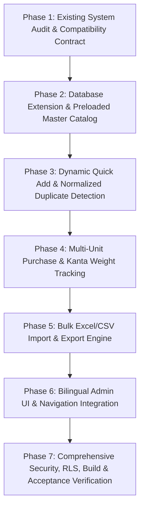

# GateWala — Dynamic Fabrication Material Master & Procurement System
## Comprehensive System Audit, Architecture & Phased Implementation Plan

**Module Version:** 1.0  
**Date:** 2026-10-27  
**Module Scope:** Raw Material Master, Dynamic Categories, Multi-Unit Procurement, Supplier Ledgers & Physical Inventory  
**Target Location:** Admin Workspace → `Inventory & Purchases` (`/admin/workspaces/inventory`)  
**Separation of Concerns:** Exclusively for raw materials & workshop consumables purchased from iron dealers/suppliers. Completely separate from customer-facing finished gates/products under `Products & Website`.

---

## 1. Phase 1 — Existing System Audit & Baseline

### 1.1 Existing Database Tables & Schema

| Existing Table | Current Fields & Types | Current Constraints & Foreign Keys | Gaps vs New Requirements |
|---|---|---|---|
| `public.materials` | `id` (uuid PK)<br>`name` (text)<br>`code` (text unique)<br>`type` (text enum check)<br>`size` (text)<br>`thickness_mm` (numeric > 0)<br>`unit` ('kg','m','piece','litre','sheet')<br>`weight_kg_per_unit` (numeric > 0)<br>`reorder_level` (numeric >= 0)<br>`active` (boolean)<br>`created_at` (timestamptz) | Referenced by `purchase_items`, `stock_movements`, `bom_items`, `stock_reservations`, `material_rates`. | Missing Hindi name (`name_hi`), local aliases (`local_aliases`), extensible categories/subcategories (`category_id`), gauge designation (`gauge`), standard length (`standard_length_m`), brand (`brand`), grade (`grade`), secondary purchase units & conversion factors. |
| `public.suppliers` | `id` (uuid PK)<br>`name` (text)<br>`phone` (text)<br>`address` (text)<br>`gst_number` (text)<br>`created_at` (timestamptz) | Referenced by `purchases.supplier_id`. | Sufficient base; needs contact person, credit period/terms, opening balance, and quick-add support in purchase workflow. |
| `public.purchases` | `id` (uuid PK)<br>`name` (text title)<br>`supplier_id` (FK)<br>`bill_number` (text)<br>`bill_date` (date)<br>`total_minor` (bigint)<br>`status` ('draft','received','cancelled')<br>`created_at` (timestamptz) | `unique(supplier_id, bill_number)` | Good foundation; supports status lifecycle and attached invoices via `purchases/[id]/attachments`. |
| `public.purchase_items` | `id` (uuid PK)<br>`purchase_id` (FK)<br>`material_id` (FK)<br>`quantity` (numeric)<br>`rate_minor` (bigint)<br>`discount_minor` (bigint)<br>`tax_bps` (int)<br>`tax_recoverable` (bool)<br>`net_minor`, `tax_minor`, `total_minor`, `inventory_minor` | Validated by trigger `purchase_price_guard()`. Immutable once received. | Only records raw canonical quantity; lacks multi-unit purchase fields (`purchase_unit`, `purchase_qty`, `conversion_ratio`), and actual received weight (weighbridge / kanta weight vs invoice weight). |
| `public.stock_movements` | `id` (uuid PK)<br>`material_id` (FK)<br>`quantity` (numeric)<br>`unit_cost_minor` (bigint)<br>`book_value_minor` (bigint)<br>`kind` ('receipt','consumption','adjustment','return')<br>`purchase_id` (FK)<br>`work_order_id` (FK)<br>`note` (text)<br>`idempotency_key` (uuid unique) | Immutable ledger. Inserted atomically on purchase receipt via `receive_purchase(target)`. | Solid atomic ledger. Needs support for tracking lot numbers, multi-unit conversions, and cutting remnants. |
| `public.stock_reservations` | `id` (uuid PK)<br>`material_id` (FK)<br>`work_order_id` (FK)<br>`quantity` (numeric)<br>`consumed_quantity` (numeric)<br>`status` ('active','consumed','released') | Enforces allocation against available stock. | Completely compatible; works cleanly with `inventory_balances()`. |
| `public.material_rates` | `id` (uuid PK)<br>`material_id` (FK)<br>`purchase_minor` (bigint)<br>`selling_minor` (bigint)<br>`effective_at` (timestamptz) | Append-only rate versioning. | Preserved for historical estimate pricing. |

### 1.2 Existing Procedures & Business Logic
1. `receive_purchase(target uuid)`: Atomically iterates `purchase_items`, updates taxes and inventory values, locks `materials` rows, posts `receipt` entries in `stock_movements`, and transitions purchase status from `draft` to `received`.
2. `return_purchase_item(payload jsonb)`: Handles purchase returns, validates unreserved stock availability, recalculates weighted average stock book value, and creates supplier credit.
3. `inventory_balances()`: View/RPC returning `material_id`, `name`, `unit`, `on_hand`, `reserved`, `available`, `reorder_level` by aggregating `stock_movements` and `stock_reservations`.
4. `post_stock(payload jsonb)`: Allows manual inventory adjustments with idempotency and audit trail.

### 1.3 Permissions & RLS Policies
- `materials.read`, `materials.write`: Grants access to catalog materials and rates.
- `purchases.read`, `purchases.write`, `purchases.approve`: Controls draft purchases, item management, and receiving.
- `inventory.read`, `inventory.approve`: Controls stock views, balances, and manual stock adjustments.
- `suppliers.read`, `suppliers.write`: Controls supplier directory and statements.
- **RLS Status:** All 58 existing tables have Row Level Security enabled and enforce `public.has_permission(...)`.

### 1.4 Architecture Reuse & Zero-Breaking-Change Guarantee
- **Preserve Foreign Keys:** `materials.id` remains the primary foreign key for `purchase_items`, `stock_movements`, `bom_items`, and `material_rates`.
- **Additive Database Extension:** We do NOT alter existing column types or drop existing columns. New tables (`material_categories`, `material_brands`, `material_grades`) and additive nullable/defaulted columns on `materials` and `purchase_items` ensure 100% backward compatibility.
- **Isolated Procurement Module:** Raw materials and purchases live exclusively under `Inventory & Purchases`. Finished products remain under `Products & Website`.

---

## 2. Phase 2 — Material Master Architecture & Predefined Catalog

### 2.1 Extensible Category & Material Taxonomy
Instead of a hardcoded enum `type text check(type in (...))`, the system introduces dynamic categories with predefined standard defaults that can be edited, augmented, or added to by admins at any time:

1. **MS Pipes (माइल्ड स्टील पाइप):**
   - Square Pipes (चौकोर पाइप / Box Pipe): 15×15mm, 19×19mm (¾"), 25×25mm (1"), 32×32mm (1¼"), 38×38mm (1½"), 50×50mm (2"), 75×75mm (3"), 100×100mm (4") in 16G, 18G, 14G, 20G.
   - Rectangular Pipes (आयताकार पाइप): 25×12mm, 40×20mm, 50×25mm (2"×1"), 60×40mm, 75×40mm (3"×1½"), 100×50mm (4"×2") in 16G, 18G, 14G.
   - Round Pipes (गोल पाइप): ½", ¾", 1", 1¼", 1½", 2", 2½", 3", 4" OD in Class A (Light/Yellow), Class B (Medium/Blue), Class C (Heavy/Red).
2. **MS Angles (लोहे का एंगल):**
   - 20×20×3mm, 25×25×3mm (1"×3mm), 25×25×5mm, 32×32×3mm (1¼"×3mm), 32×32×5mm, 40×40×3mm (1½"×3mm), 40×40×5mm, 40×40×6mm, 50×50×5mm (2"×5mm), 50×50×6mm, 65×65×6mm.
3. **MS Flat Bars & Patti (लोहे की पत्ती):**
   - 12×3mm, 19×3mm (¾"×3mm), 25×3mm (1"×3mm), 25×5mm, 32×5mm, 40×5mm, 50×6mm, 75×6mm.
4. **MS Solid Round & Square Bars (सरिया / ठोस छड़):**
   - Round Bar (गोल सरिया): 6mm, 8mm, 10mm, 12mm, 16mm, 20mm, 25mm.
   - Square Bar (चौकोर सरिया / गुल्ला): 8×8mm, 10×10mm, 12×12mm, 16×16mm.
   - Bright Bar: High-precision turned bars for hinges and pins.
5. **MS Channels & Beams (चैनल और गर्डर):**
   - Channels: ISMC 75×40, ISMC 100×50, ISMC 125×65, ISMC 150×75.
   - Beams / Joists: ISMB 100, ISMB 125, ISMB 150.
6. **Sheets & Plates (लोहे की चादर व प्लेट):**
   - Hot Rolled (HR) Sheets: 10G (3.2mm), 12G (2.5mm), 14G (2.0mm), 16G (1.6mm).
   - Cold Rolled (CR) Sheets: 18G (1.2mm), 20G (0.9mm), 22G (0.8mm).
   - Galvanized (GI / GP) Plain Sheets: 18G, 20G, 22G, 24G (Tata Shaktee / Jindal).
   - Chequered Plates (चेकर्ड प्लेट - पायदान चादर): 3mm, 4mm, 5mm.
   - Perforated / Jali Sheets: Round hole, square hole, capsule hole.
   - CNC / Laser Decorative Cut Sheets: 1.6mm, 2.0mm, 3.0mm.
7. **Stainless Steel Materials (स्टेनलेस स्टील):**
   - Grades: SS 202 (economy), SS 304 (premium weather-resistant).
   - SS Square/Rectangular Pipes, Round Pipes (mirror / satin / matte).
   - SS Sheets, decorative balls, bends, caps, and glass studs.
8. **Aluminium Materials (एल्युमिनियम):**
   - Sliding window sections, door frame sections, louvers, ACP sheets (3mm, 4mm).
9. **Gate Hardware & Accessories (गेट का सामान):**
   - Heavy ball-bearing pivot hinges (कब्जा - 3", 4", 5"), side hinges.
   - Tower bolts (सिटकनी / कुंडी - 6", 8", 10", 12"), drop pins.
   - Gate wheels & rollers (heavy duty V-groove / U-groove wheels with double bearings).
   - Sliding gate track channels, bottom guide rollers, stoppers.
   - Heavy mortise locks, padlock eye-plates.
   - Cast iron / forged steel decorative spears (भाला / तीरकमान), flower motifs, rings.
10. **Welding Consumables (वेल्डिंग सामग्री):**
    - Shielded Metal Arc Electrodes: E6013 (2.5mm / 12G, 3.15mm / 10G, 4.0mm / 8G) (Esab / Advani / D&H).
    - CO2 / MIG Welding Wire: ER70S-6 (0.8mm, 1.2mm spools).
    - Shielding Gas: Commercial CO2 cylinders, Industrial Argon.
    - Welding nozzles, contact tips, holders, earth clamps, face masks.
11. **Cutting & Grinding Tools (कटिंग व ग्राइंडिंग डिस्क):**
    - 4" Cutting Wheels (पतला कटिंग व्हील), 4" Grinding Wheels (मोटा घिसाई व्हील).
    - 14" Cut-off Chop Saw Wheels.
    - Flap Discs (Zirconia / Alumina - 60, 80, 120 grit), Wire cup brushes.
12. **Paints & Finishing (पेंट और फिनिशिंग):**
    - Red Oxide Metal Primer (रेड ऑक्साइड प्राइमर), Zinc Phosphate Primer.
    - Synthetic Enamel Paints (Gloss Black, Dark Brown, White, Golden, Silver).
    - NC Putty, Thinner (NC / Enamel thinner), Sandpaper (80, 120, 220 grit).
13. **Roofing & Shed Materials (शेड व रूफिंग):**
    - Color Coated Trapezoidal Profile Sheets (0.45mm, 0.50mm - Blue, Terracotta, White).
    - Polycarbonate Embossed / Multiwall Sheets.
    - Self-Drilling Hex Screws with EPDM Washers (12×25mm, 12×50mm).
    - Turbo ventilators, ridge caps, flashing.
14. **Fasteners & Civil Fixtures (फास्टनर और फिटिंग):**
    - Heavy duty anchor bolts / rawl bolts (8×75mm, 10×100mm, 12×125mm).
    - Hex bolts, nuts, plain washers, spring washers (MS & GI).
    - Blind pop rivets, through bolts.

---

## 3. Phase 3 — Dynamic Quick Add & Duplicate Prevention

### 3.1 Inline Quick Add Dialogs
In fabrication procurement, workshop staff entering supplier purchase bills often encounter newly introduced sizes, brands, or hardware items. Leaving the purchase form causes lost data and frustration.
- **Direct Creation in Purchase Form:** Next to the material selector in the purchase entry form, a **"+ नया मटेरियल जोड़ें (Quick Add)"** button opens a non-destructive inline modal.
- Once created, the new material is instantly selected in the purchase item line with all defaults loaded, without losing already-entered bill lines.
- Similar inline quick-add dialogs for:
  - Add Category / Subcategory
  - Add Supplier / Vendor
  - Add Brand / Manufacturer
  - Add Grade / Gauge specification

### 3.2 Duplicate Prevention & Normalization Engine
- **Normalized Specification Matching:**
  Fabricators describe the same pipe as `"25x25 18g"`, `"1x1 18 gauge"`, `"1 inch square pipe 18G"`, or `"25mm sq pipe"`.
  The duplicate prevention engine normalizes:
  - Metric vs Imperial: `1 inch` = `25.4mm` (nominal 25mm).
  - Gauge to nominal thickness: `18G` = `1.2mm`, `16G` = `1.6mm`, `14G` = `2.0mm`.
  - Shape & Type: Square pipe, Angle, etc.
- When saving, if a material with identical normalized dimensions (`shape`, `size_mm`, `thickness_mm`) already exists, the system alerts the user and offers to link the alias or view the existing record instead of creating redundant duplicate entries.

---

## 4. Phase 4 — Multi-Unit Procurement & Physical Stock Management

### 4.1 Multi-Unit Purchase Conversion
Fabrication raw materials are bought in commercial trade units that differ from storage or fabrication usage:
- **Pipes & Tubes:** Wholesalers sell by **Bundle** (e.g. 4 pipes of 20ft each) or by **Weight (KG)** or by **Piece (20ft length)**.
- **Angles & Flats:** Wholesalers sell by **KG** (weighed on dharam kanta) or by **Bundle** or by **Piece**.
- **Sheets:** Sold by **Sheet** (e.g. 8×4 ft) or by **KG**.
- **Hardware & Consumables:** Sold by **Box** (e.g. 50 pieces of hinges, 5 kg packet of electrodes) or **Piece**.
- **Paints:** Sold by **Litre / Drum** (1L, 4L, 20L).

**Purchase Line Multi-Unit Model:**
```
Purchase Input:
[Quantity] 10 [Unit] Bundle (4 pcs/bundle = 40 pcs, 20 ft each)
[Rate] ₹2,800 per Bundle = Total ₹28,000
Conversion to Canonical Stock:
40 Pieces @ 20ft (Total 800 ft / ~480 kg)
```

### 4.2 Actual Received Weight (Kanta / Weighbridge Reconciliation)
- Steel bills often charge by theoretical weight (e.g., 500 kg), but the actual delivery received on the workshop weighbridge (धर्म कांटा) is 492 kg or 504 kg.
- The system supports recording:
  - **Billed Weight (बिल का वजन):** Used for financial ledger & invoice reconciliation.
  - **Actual Received Weight (कांटा वजन):** Used for actual physical stock ledger and consumption costing.
  - Variance alert when variance exceeds configured tolerance (e.g. ±2%).

---

## 5. Phase 5 — Bulk Excel/CSV Import & Export

- **CSV / Excel Import Engine:**
  - Standard downloadable templates for:
    1. Material Master Catalog (bilingual columns).
    2. Supplier Directory.
    3. Opening Stock Balances.
  - Features:
    - Pre-import data validation with line-by-line error highlights.
    - Duplicate detection preview.
    - Partial import (skip errors, import valid rows, download error report).
- **Export Engine:**
  - One-click filtered CSV export of all Materials, Low-Stock items, Stock valuations, and Supplier bills.

---

## 6. Phase 6 — Bilingual Admin UI Architecture

Under `Inventory & Purchases` (`/admin/workspaces/inventory`), the following dedicated pages and workflows are established:

```
Inventory & Purchases (इन्वेंट्री और खरीद)
├── 1. स्टॉक ओवरव्यू (Stock Overview & Low-Stock Alerts) -> /admin/inventory
├── 2. मटेरियल लाइब्रेरी (All Materials Master) -> /admin/materials
├── 3. नई सामग्री जोड़ें (Add Material & Quick Setup) -> /admin/materials?new=1
├── 4. मटेरियल श्रेणियां (Material Categories) -> /admin/material-categories
├── 5. आपूर्तिकर्ता / वेंडर (Suppliers & Ledger Statements) -> /admin/suppliers
├── 6. खरीद बिल / पर्ची (Purchase Entries & Invoices) -> /admin/purchases
├── 7. स्टॉक लेज़र (Stock Movement Ledger) -> /admin/stock-movements
├── 8. एक्सेल इम्पोर्ट / एक्सपोर्ट (Bulk CSV Import/Export) -> /admin/materials/import
└── 9. मटेरियल खपत व जॉब उपयोग (Material Usage & Allocation) -> /admin/stock-reservations
```

All screens feature:
- Clean Bilingual Hindi/English typography with Indian Rupee (`₹`) formatting.
- Search by English name, Hindi name, size, or local alias (e.g. "1.25 inch", "सवा इंची", "18 gauge").
- Quick filter pills for material categories (Pipes, Angles, Sheets, Hardware, Paints, etc.).
- Mobile-responsive design tested across 320px to 1920px viewports.

---

## 7. Phased Implementation Roadmap & Verification Gates



### Detailed Phase Gates:

1. **Phase 1 (Complete Audit & Architecture):**
   - Review current tables, RLS policies, trigger guards, and financial workflows.
   - Establish non-breaking compatibility contracts.
   - *Gate: Audit approved and recorded in docs.*

2. **Phase 2 (Database Extension & Preloaded Master Dataset):**
   - Create additive SQL migration for `material_categories`, `material_brands`, and extended material fields.
   - Seed comprehensive, industry-standard fabrication catalog (120+ standard items across 14 categories).
   - *Gate: Clean migration application, zero existing test regressions.*

3. **Phase 3 (Dynamic Quick Add & Duplicate Detection):**
   - Build `MaterialQuickAddModal` and category/brand inline creators.
   - Implement specification normalization and duplicate detection algorithm.
   - *Gate: Unit tests for duplicate matching and inline creation pass.*

4. **Phase 4 (Multi-Unit Procurement & Kanta Weight Reconciliation):**
   - Enhance `purchase-items` and purchase entry workflow with multi-unit converter (Bundle, Box, Piece, KG, Feet).
   - Implement Actual Received Weight vs Billed Weight tracking.
   - *Gate: Purchase receipt transaction test and supplier statement reconciliation pass.*

5. **Phase 5 (Bulk CSV/Excel Import & Export Engine):**
   - Build robust CSV parser, template generator, validation preview, and batch insert.
   - *Gate: Test with 100-row sample CSV import without schema failure.*

6. **Phase 6 (Bilingual Admin UI in Inventory & Purchases):**
   - Update navigation and create bilingual material management screens.
   - Implement category filter pills, stock status indicators, and quick action bars.
   - *Gate: Mobile and desktop layout checks pass.*

7. **Phase 7 (Security, RLS, Quality & Verification):**
   - Run typecheck, unit tests, integration tests, and production build.
   - Verify Supabase RLS and permission checks.
   - Commit and push to `origin/main` for live Vercel deployment.
   - *Gate: 100% test pass rate, clean build, live deployment active.*
